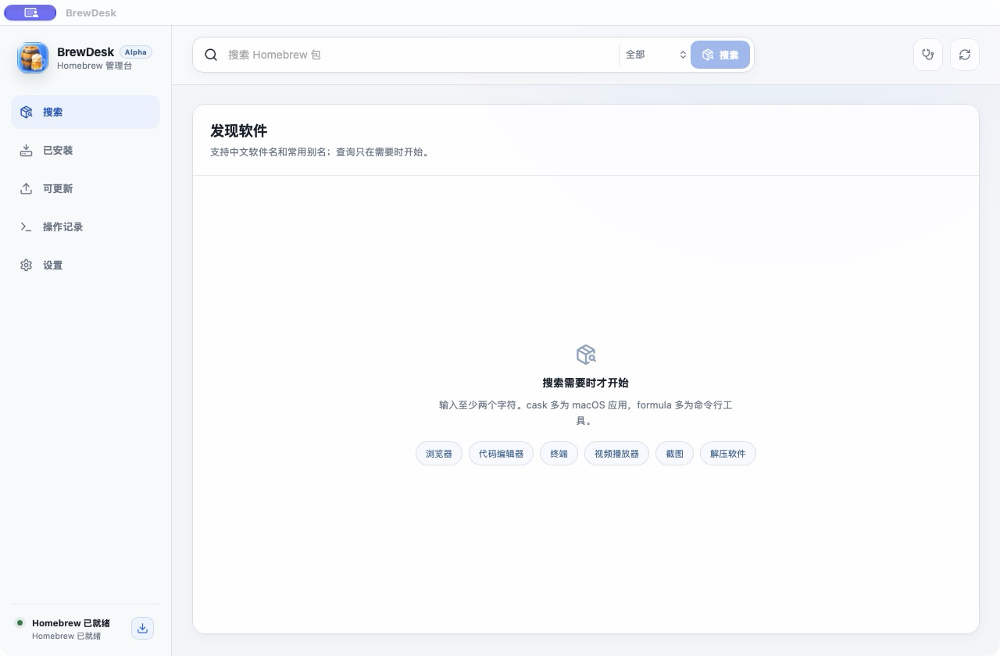

# BrewDesk

A Chinese-first desktop interface for Homebrew. Search packages, check what is installed, and review the command before running it.

[简体中文](README.zh-CN.md)

## Features

- Search Formulae and Casks by English name, Chinese name, or local aliases. View versions, dependencies, and package details.
- Preview commands before installing, uninstalling, upgrading, or repairing packages, then follow their output and progress.
- Get a warning when another application occupies the target path, so you can check before replacing an existing installation.
- Browse available updates. Lists refresh in the background and remember your scroll position when you return.
- Use a system proxy, direct connection, or mirror for the current task without changing system or shell settings.

Homebrew operations that make changes run one at a time. See the [update notes](docs/UPDATE_RELIABILITY.md) for more detail.

## Using and building BrewDesk

This is a source Alpha. The verified environment is **Apple Silicon on macOS 26**. Intel Macs, macOS 14, and macOS 15 have not been verified.

The [release page](https://github.com/Tsing-duan/brewdesk-homebrew/releases/tag/v0.1.0-alpha.1) provides source code. There is no application installer yet, and Developer ID signing and Apple notarization are not complete.

Building from source requires Node.js 24 and the repository's specified Rust toolchain. See the [development guide](docs/development.md) for environment setup, build-directory requirements, and check commands.

## Before using it

- BrewDesk does not collect sudo passwords. Interactive Homebrew installation runs in Terminal.
- There is no telemetry, account system, analytics SDK, or software-inventory upload.
- Application-origin detection can be incomplete. Review any installation conflict yourself before proceeding.
- Passing a network check does not guarantee that every third-party download host will work.
- The interface has mainly been evaluated in Chinese.

## Documentation and feedback

- [Known limitations](docs/KNOWN_LIMITATIONS.md) and [verification records](docs/verification-notes.md)
- [Security model](docs/SECURITY_MODEL.md) and [network settings](docs/NETWORK_ROUTING.md)
- [Roadmap](docs/ROADMAP.md) and [contributing](CONTRIBUTING.md)
- [Support](SUPPORT.md) and [security reports](SECURITY.md)

## Attribution and license

BrewDesk is an independent community project that uses Homebrew. It is not affiliated with Homebrew.

Source code uses the [MIT License](LICENSE). Third-party dependencies retain their own terms; see [NOTICE.md](NOTICE.md). The application icon was generated with Codex; see [asset sources](docs/ASSET_SOURCES.md).
