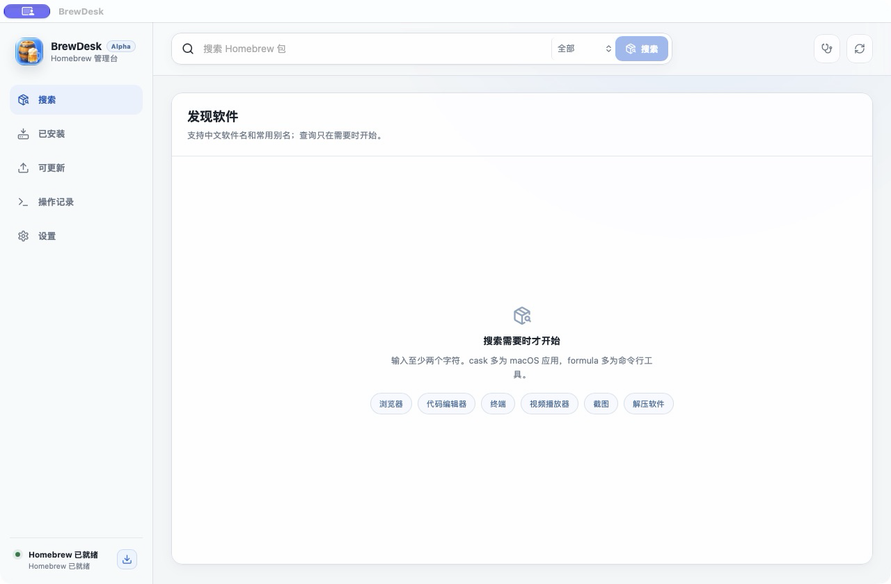

# BrewDesk

给 Homebrew 加一个中文桌面界面：搜索软件、查看安装情况，在操作前确认实际要执行的命令。

[English](README.md)

## 功能

- 用英文名称、中文名称或本地别名搜索 Formula 和 Cask，查看版本、依赖和包详情。
- 安装、卸载、更新或修复前预览 Homebrew 命令，执行时查看输出和进度。
- 目标位置已有其他来源的应用时提醒，避免不知情地覆盖现有安装。
- 查看可更新的软件；列表在后台刷新，返回时保留滚动位置。
- 为当前任务使用系统代理、直连或镜像，不改写系统或 Shell 设置。

Homebrew 修改操作会依次执行。更多细节见[更新说明](docs/UPDATE_RELIABILITY.md)。

## 使用与构建

目前是源码 Alpha，已验证环境为 **Apple Silicon Mac 和 macOS 26**。Intel Mac、macOS 14 和 macOS 15 尚未验证。

[Release 页面](https://github.com/Tsing-duan/brewdesk-homebrew/releases/tag/v0.1.0-alpha.1)提供源码，暂时没有安装包，也未完成 Developer ID 签名和 Apple 公证。

从源码构建需要 Node.js 24 和仓库指定的 Rust 工具链。环境设置、构建目录要求与检查命令见[开发说明](docs/development.md)。

## 使用前了解

- 不采集 sudo 密码。需要交互的 Homebrew 安装会交给 Terminal 完成。
- 不包含遥测、账号系统、分析 SDK 或软件清单上传。
- 安装来源判断可能不完整，冲突提示不能替代手动确认。
- 网络检查通过不保证所有第三方软件下载站都可用。
- 界面主要在中文环境下验证。

## 文档与反馈

- [已知限制](docs/KNOWN_LIMITATIONS.md)与[验证记录](docs/verification-notes.md)
- [安全模型](docs/SECURITY_MODEL.md)与[网络设置](docs/NETWORK_ROUTING.md)
- [路线图](docs/ROADMAP.md)与[贡献指南](CONTRIBUTING.md)
- [问题反馈](SUPPORT.md)与[安全问题报告](SECURITY.md)

## 来源与许可证

BrewDesk 是调用 Homebrew 的独立社区项目，与 Homebrew 官方无关。

源码采用 [MIT License](LICENSE)。第三方依赖保留各自许可，见 [NOTICE.md](NOTICE.md)。应用图标由 Codex 生成，见[素材来源](docs/ASSET_SOURCES.md)。
